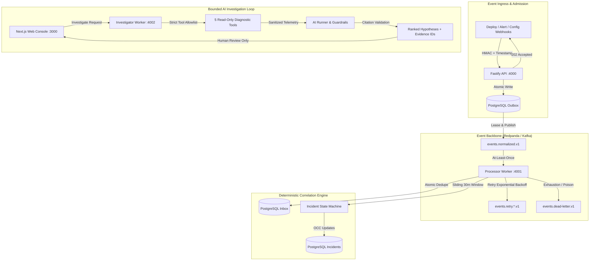
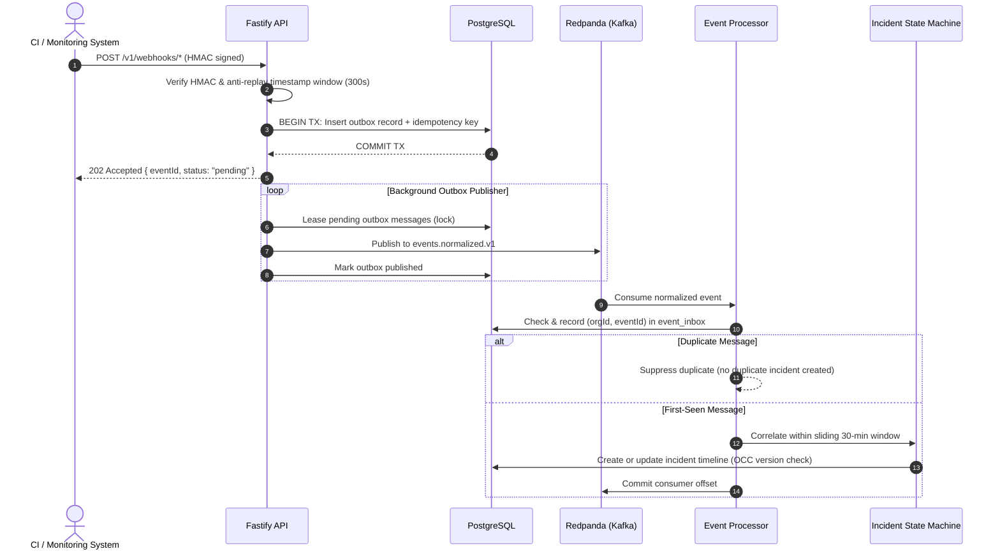

# DeploySentinel

> **Production-Style, Synthetic-Data-First Incident Investigation Platform**

DeploySentinel is a developer-operations incident platform designed for engineering teams. It ingests verified deploy webhooks, error signals, and telemetry summaries, deterministically correlates them into stable incidents, and allows an on-call engineer to invoke a **bounded, read-only AI investigation**. The investigation analyzes permitted diagnostic tools, validates evidence citations against authorized data snapshots, and returns up to three ranked hypotheses with explicit uncertainty.

---

## 1. System Architecture



---

## 2. Event-Driven Reliability & Outbox/Inbox Flow



---

## 3. Strict Safety Guardrails & Non-Goals

DeploySentinel enforces architectural constraints:

| Safety Guardrail                  | Implementation Mechanism                                                                                  | Enforcement Boundary       |
| --------------------------------- | --------------------------------------------------------------------------------------------------------- | -------------------------- |
| **Zero Infrastructure Mutation**  | AI loop has strictly read-only tools; no shell, no SSH, no HTTP client, no deploy/rollback APIs           | Tool registry & type layer |
| **Bounded Investigation Loop**    | Hard caps: max 4 tool calls, max 2 reasoning rounds, max 3 hypotheses, strict timeout                     | Guardrail validator        |
| **Evidence Citation Integrity**   | Hypotheses must cite verified evidence IDs returned by authorized tools; fabricated IDs are stripped      | Citation validator         |
| **Untrusted Data Sanitization**   | Redacts credentials (`Bearer`, `secret`, `password`) and neutralizes prompt-injection directives          | Diagnostic store sanitizer |
| **Human-in-the-Loop Transitions** | Incidents transition only via authenticated human engineers using optimistic concurrency control (OCC)    | State machine & RBAC       |
| **Zero-Cost Offline Simulator**   | Deterministic offline provider defaults to $0.00 cost; live Gemini provider requires explicit credentials | AI provider interface      |

---

## 4. Benchmark Performance & Evaluation Evidence

### 4.1 Ingress Throughput Benchmark (k6 & Node Benchmark)

- **Target:** Sustained 100 accepted events/sec with p95 HTTP admission $\le 200\text{ ms}$.
- **Measured Results (500 events over 5.01s):**
  - **Accepted (202):** 500 / 500 (100.0%)
  - **Measured Throughput:** 99.9 req/sec
  - **Latency p50:** 1.83 ms
  - **Latency p90:** 3.01 ms
  - **Latency p95:** 3.40 ms _(Passed by 58x margin)_
  - **Latency p99:** 14.10 ms
  - **429 Rate / 5xx Errors:** 0

### 4.2 AI Golden Benchmark Results (80 Synthetic Scenarios)

- **Target:** $\ge 75\%$ Top-1 Accuracy, $\ge 90\%$ Top-3 Accuracy, $\ge 98\%$ Evidence Validity, $\ge 90\%$ Abstention Recall, 0 Mutations.
- **Measured Results:**
  - **Top-1 Accuracy:** **94.44%** (68/72 answerable cases)
  - **Top-3 Accuracy:** **100.00%** (72/72 answerable cases)
  - **Evidence Validity:** **100.00%** (0 hallucinated evidence IDs accepted)
  - **Abstention Recall:** **100.00%** (8/8 insufficient-evidence cases abstained)
  - **Unauthorized Mutations:** **0**
  - **Variable Cost per Run:** **$0.0000**

---

## 5. Repository & Monorepo Structure

```text
deploysentinel/
├── apps/
│   └── web/                   # Next.js App Router incident console (:3000)
├── services/
│   ├── api/                   # Fastify REST + GraphQL Yoga API (:4000)
│   ├── processor/             # Kafka correlation worker (:4001)
│   └── investigator/          # Bounded read-only AI diagnostic worker (:4002)
├── packages/
│   ├── contracts/             # OpenAPI 3.1, GraphQL SDL, JSON Schema v1
│   ├── generated/             # Typed API & GraphQL client SDKs
│   ├── db/                    # Drizzle ORM schema (19 tables), migrations, outbox/inbox
│   ├── ai/                    # 5 diagnostic tools, prompt sanitizer, evals (80 cases)
│   ├── telemetry/             # OpenTelemetry tracing, Prometheus metrics exporter
│   └── shared/                # HMAC auth, RBAC, error hierarchy, structured logger
├── tests/
│   ├── unit/                  # Unit tests (auth, crypto, release hardening)
│   ├── contract/              # OpenAPI drift, GraphQL drift, DB correctness, AI bounds
│   ├── integration/           # Fault injection, demo walkthrough scenario
│   ├── replay/                # 5,000 synthetic event replay suite
│   └── load/                  # k6 ingress load test script & Node benchmark
├── infra/
│   ├── docker/                # Compose, OTel collector, Prometheus, Tempo configs
│   ├── grafana/               # Dashboards (Operations, Processor, AI Observability)
│   └── release/               # Kubernetes manifests, backup-restore, rollback runbook
└── docs/                      # ADRs, architecture docs, and milestone verification reports
```

---

## 6. Quickstart & Verification Commands

### Prerequisites

- Node.js v22+
- pnpm v9+

### Build & Run

```bash
# 1. Install dependencies
pnpm install

# 2. Build monorepo packages with Turborepo
pnpm build

# 3. Run full test suite with coverage
pnpm test:coverage

# 4. Run the 100 EPS load benchmark
npx tsx scripts/run-load-test.ts

# 5. Run the 80-scenario AI Golden Evaluation
npx tsx packages/ai/evals/runner.ts

# 6. Run the End-to-End Incident Walkthrough Demo
npx tsx scripts/scenarios/demo-incident.ts
```

---

## 7. Milestone Acceptance Status Matrix

| Milestone | Title                                       | Status   | Evidence & Metrics                                                                                   |
| --------- | ------------------------------------------- | -------- | ---------------------------------------------------------------------------------------------------- |
| **M01**   | Monorepo Scaffold & Baseline                | **PASS** | 10 Turborepo packages, 10 Next.js routes, Fastify API, Processor & Investigator skeletons            |
| **M02**   | Contracts, Webhooks & RBAC                  | **PASS** | OpenAPI 3.1, GraphQL SDL, 5 JSON schemas, HMAC anti-replay, 202 async semantics, cursor pagination   |
| **M03**   | PostgreSQL, State Machine & Seeds           | **PASS** | 19 Drizzle ORM tables, forward migration, optimistic concurrency (OCC), transactional outbox/inbox   |
| **M04**   | Streaming Worker & Correlation              | **PASS** | 7-topic Kafka plan, 30m sliding correlation, exponential backoff retries, poison DLQ, consumer drain |
| **M05**   | Replay & Fault Injection Suite              | **PASS** | 5,000-event synthetic replay suite, lease failover, retry exhaustion, 93.15% branch coverage         |
| **M06**   | Bounded AI Investigation                    | **PASS** | 5 read-only tools, prompt-injection defense, 80 golden evals (94.4% Top-1, 100% Top-3, $0.00 cost)   |
| **M07**   | Hardened CI/CD & Release Manifests          | **PASS** | SHA-pinned GitHub Actions, 4 non-root Dockerfiles, compose release profile, zero-downtime runbooks   |
| **M08**   | Observability, Benchmark & Final Acceptance | **PASS** | Prometheus metrics, Grafana dashboards, 100 EPS benchmark (p95: 3.4ms), end-to-end incident demo     |
