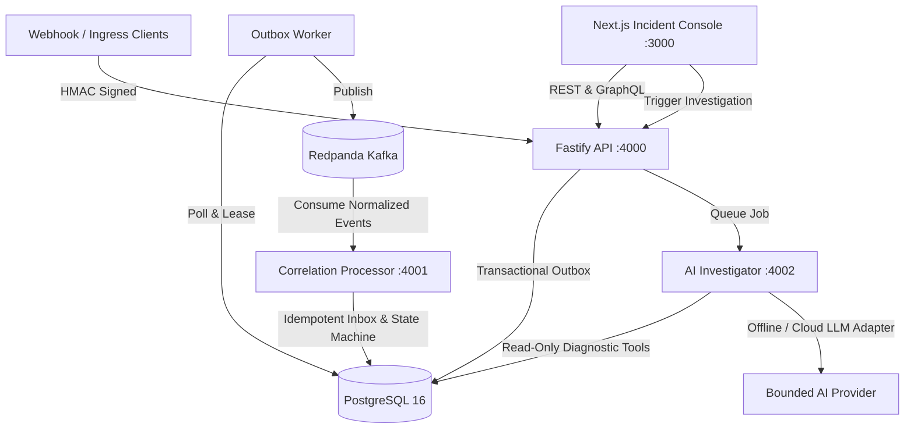

# DeploySentinel Architecture Overview

## Core Components

- **apps/web**: Next.js App Router incident operations console.
- **services/api**: Fastify REST API and GraphQL Yoga endpoint handling authentication, ingress webhooks, and state queries.
- **services/processor**: Kafka stream processor correlating deployments, error spikes, and alerts into deterministic incident state transitions.
- **services/investigator**: Bounded read-only diagnostic agent executing structured root-cause hypotheses with verified evidence citations.
- **packages/shared**: Common utilities, environment validation, HMAC cryptography, structured logging, and errors.
- **packages/contracts**: Canonical OpenAPI 3.1 specification, GraphQL schema, and versioned JSON Schema event envelopes.
- **packages/db**: Drizzle ORM schemas, database migrations, connection pool, and synthetic seed datasets.
- **packages/ai**: Provider adapters, read-only diagnostic tool registry, and golden evaluation suite.
- **packages/telemetry**: OpenTelemetry tracing, Prometheus metrics registry, and log correlation.
